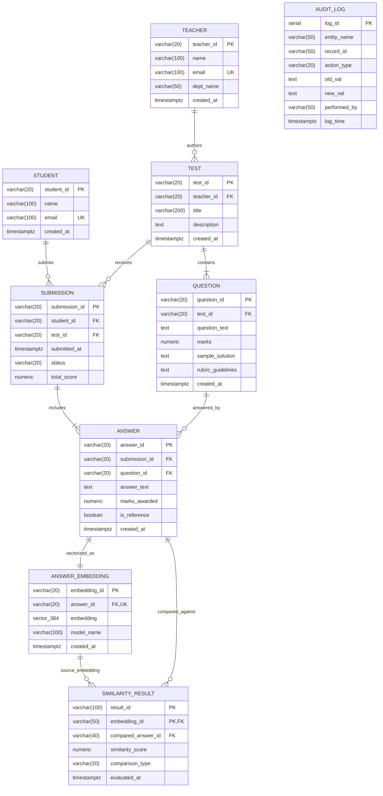

# Automated Test Evaluation & Vector Similarity System

> **PES University - Department of Computer Science & Engineering**  
> **Course:** Database Management Systems (DBMS Experiential Learning - Level 3 Project)  
> **Course Instructors:** Dr. Deena Hajim, Prof. Nagasundari S  
> **Team Members:**  
> - **Ananya Ratnaparkhi** - `PES2UG24CS058`  
> - **Hemanth Andey** - `PES2UG24CS061`  
> **Database:** PostgreSQL 16 with `pgvector` Extension (SQL + Vector Dual Paradigm)  
> **Architecture:** Next.js Fullstack UI + Python FastAPI Vector Microservice + PostgreSQL 16

---

## 1. Problem Statement & Motivation

Subjective and descriptive questions in technical examinations (e.g., explaining database isolation levels, B+ tree mechanics, normalization forms) are labor-intensive to grade manually and prone to evaluation fatigue and inconsistency. Traditional automated grading tools rely on rigid keyword matching or regular expressions, which fail to recognize valid student answers expressed with alternative technical terminology, paraphrasing, or varying sentence structures.

Furthermore, academic dishonesty and collusion detection across descriptive answers is difficult to identify manually across large cohorts because collaborating students rephrase identical conceptual answers.

**Our Solution:**  
This project implements an **Automated Test Evaluation and Vector Similarity System** utilizing a dual-paradigm database architecture combining relational SQL with dense vector embeddings via PostgreSQL and the `pgvector` extension. The system performs two operations:
1. **Student vs. Teacher Benchmark Evaluation:** Computes semantic similarity between a student's answer and the teacher's benchmark solution using dense 384-dimensional embeddings (`sentence-transformers/all-MiniLM-L6-v2`), awarding grades dynamically through stored procedures and reactive triggers.
2. **Student vs. Student Pairwise Plagiarism & Collusion Detection:** Performs an N x N cross-comparison across all student submissions for every question, rendering an interactive collusion heatmap matrix that highlights suspicious clusters and identical conceptual submissions.

---

## 2. Objectives

- Automate the semantic grading of subjective, free-text technical answers against reference answers with high accuracy.
- Detect conceptual student collusion and plagiarism across descriptive answers using pairwise vector distance comparisons.
- Implement an enterprise-grade relational schema enforcing referential integrity, domain constraints, and audit logging.
- Combine relational SQL with a vector database in a single PostgreSQL instance using the `pgvector` extension.
- Provide a responsive Next.js web application supporting role-based workflows for teachers and students, alongside a real-time DBMS verification showcase.

---

## 3. Scope

- **In Scope:**
  - Test authoring with question benchmarks and customizable rubrics.
  - Multi-student subjective test taking with real-time semantic grading.
  - Real-time trigger-based score recomputations and audit trail logging.
  - Pairwise similarity matrix calculation for cross-student collusion analysis.
  - Live relational view querying and EXPLAIN ANALYZE execution plan inspections for HNSW vector indexes.
  - Full CRUD operations: CREATE, ALTER, DROP, INSERT, UPDATE, and cascading DELETE.
- **Out of Scope:**
  - Automated generation of test questions using generative AI.
  - Proctoring through webcam or audio feeds.

---

## 4. Functional Requirements

1. **Role-Based Portals:** Instant persona switching between Teacher (`Dr. Deena Hajim`, `Prof. Nagasundari S`) and Student (`Ananya Ratnaparkhi`, `Hemanth Andey`).
2. **Test Authoring (Teacher):** Create tests, specify questions, set maximum marks, and supply reference model benchmark answers.
3. **Automated Batch Evaluation (Teacher):** Trigger pgvector batch evaluations against benchmark solutions, computing similarity scores and tiered grades.
4. **Collusion Matrix Heatmap (Teacher):** Visualize pairwise similarity scores per question, flagging student pairs exceeding the 85% collusion threshold.
5. **Search & Filter (Teacher):** Search student submissions by student name, SRN, or test title, with status filtering (Evaluated, Pending).
6. **Cascading Test & Submission Deletion (Teacher):** Delete invalid tests or submissions with automatic cascading removal of questions, submissions, answers, embeddings, and similarity records, accompanied by audit logging.
7. **Test Attempt & Submission (Student):** Take assigned tests, enter descriptive answers, and submit for instant vector evaluation.
8. **Scorecard & Breakdown Review (Student):** Review overall scores, percentages, and question-by-question semantic similarity match percentages alongside teacher reference solutions.
9. **DBMS Verification Hub (Showcase):** Query live relational views, run EXPLAIN ANALYZE on vector similarity queries, and test live triggers interactively.

---

## 5. ER Diagram



---

## 6. Relational Schema Representation

The relational schema is converted from the conceptual ER diagram into 3NF normalized relations:

- **`TEACHER`** (<ins>`teacher_id`</ins>, `name`, `email`, `dept_name`, `created_at`)
- **`TEST`** (<ins>`test_id`</ins>, `#teacher_id`, `title`, `description`, `created_at`)
- **`QUESTION`** (<ins>`question_id`</ins>, `#test_id`, `question_text`, `marks`, `sample_solution`, `rubric_guidelines`, `created_at`)
- **`STUDENT`** (<ins>`student_id`</ins>, `name`, `email`, `created_at`)
- **`SUBMISSION`** (<ins>`submission_id`</ins>, `#student_id`, `#test_id`, `submitted_at`, `status`, `total_score`)
- **`ANSWER`** (<ins>`answer_id`</ins>, `#submission_id`, `#question_id`, `answer_text`, `marks_awarded`, `is_reference`, `created_at`)
- **`ANSWER_EMBEDDING`** (<ins>`embedding_id`</ins>, `#answer_id`, `embedding [vector(384)]`, `model_name`, `created_at`)
- **`SIMILARITY_RESULT`** (<ins>`result_id`, `#embedding_id`</ins>, `#compared_answer_id`, `similarity_score`, `comparison_type`, `evaluated_at`)
- **`AUDIT_LOG`** (<ins>`log_id`</ins>, `entity_name`, `record_id`, `action_type`, `old_val`, `new_val`, `performed_by`, `log_time`)

*Legend:* `<ins>Underlined</ins>` = Primary Key; `#prefix` = Foreign Key; `<ins>Composite Underline</ins>` = Weak Entity Identifying Primary Key.

---

## 7. Database Choice & Justification

The requirements mandate using at least two database paradigms. We adopted **Option 2: SQL + Vector Database** within a single **PostgreSQL 16 + pgvector** deployment.

### Why SQL (PostgreSQL 16)?
1. **Strict ACID Guarantees:** Test submissions, grades, student records, and audit logs require serializable transaction isolation and consistency. A student submission cannot partially record answers while dropping submission metadata.
2. **Referential Integrity & Cascading:** Foreign keys (`ON DELETE CASCADE ON UPDATE CASCADE`) ensure that deleting a test or submission automatically purges associated questions, answers, embeddings, and similarity rows without leaving orphaned records.
3. **Database-Level Business Logic:** PostgreSQL triggers (`BEFORE/AFTER UPDATE`) and stored procedures execute transactional score recalculations and audit logging directly inside the database engine, eliminating network roundtrips.

### Why Vector Database (pgvector)?
1. **Semantic Understanding:** Traditional SQL `LIKE` or regex queries cannot match "Atomicity ensures all operations commit or abort" with "Atomicity follows an all-or-nothing rule". Vector embeddings map semantic meaning into dense high-dimensional vectors where conceptual similarity equals geometric proximity.
2. **In-Database Similarity Operations:** pgvector provides the cosine distance operator (`<=>`) computed directly in SQL queries:
   $$\text{Cosine Distance}(\vec{u}, \vec{v}) = 1 - \frac{\vec{u} \cdot \vec{v}}{\|\vec{u}\| \|\vec{v}\|}$$
3. **HNSW Index Optimization:** Rather than computing brute-force $O(N)$ comparisons across every stored answer, Hierarchical Navigable Small World (HNSW) graphs index vector spaces to enable logarithmic $O(\log N)$ nearest-neighbor retrieval.
4. **Single-Engine Co-location:** Using pgvector avoids the consistency synchronization bugs, dual-write failure modes, and operational complexity of running separate SQL and vector databases (such as MySQL + Pinecone/Chroma).

---

## 8. Data Dictionary

### 8.1 Table: `TEACHER`
| Column | Type | Nullable | Key / Constraint | Description |
|---|---|---|---|---|
| `teacher_id` | VARCHAR(20) | NO | PK | Unique teacher identifier (e.g. T101) |
| `name` | VARCHAR(100) | NO | - | Full name of the teacher |
| `email` | VARCHAR(100) | NO | UNIQUE, CHECK (RFC format) | Institutional email address |
| `dept_name` | VARCHAR(50) | NO | DEFAULT 'Computer Science' | Academic department |
| `created_at` | TIMESTAMPTZ | YES | DEFAULT CURRENT_TIMESTAMP | Account creation timestamp |

### 8.2 Table: `TEST`
| Column | Type | Nullable | Key / Constraint | Description |
|---|---|---|---|---|
| `test_id` | VARCHAR(20) | NO | PK | Unique test identifier (e.g. TEST_DBMS_01) |
| `teacher_id` | VARCHAR(20) | NO | FK -> TEACHER.teacher_id | Authoring instructor |
| `title` | VARCHAR(200) | NO | - | Title of the test |
| `description` | TEXT | YES | - | Test syllabus and instructions |
| `created_at` | TIMESTAMPTZ | YES | DEFAULT CURRENT_TIMESTAMP | Creation timestamp |

### 8.3 Table: `QUESTION`
| Column | Type | Nullable | Key / Constraint | Description |
|---|---|---|---|---|
| `question_id` | VARCHAR(20) | NO | PK | Unique question identifier (e.g. Q101) |
| `test_id` | VARCHAR(20) | NO | FK -> TEST.test_id | Parent test |
| `question_text` | TEXT | NO | - | Subjective prompt text |
| `marks` | NUMERIC(5,2) | NO | DEFAULT 1.00, CHECK (marks > 0) | Maximum marks for the question |
| `sample_solution` | TEXT | YES | - | Reference benchmark answer |
| `rubric_guidelines` | TEXT | YES | - | Grading rubric guidelines (via ALTER TABLE) |
| `created_at` | TIMESTAMPTZ | YES | DEFAULT CURRENT_TIMESTAMP | Creation timestamp |

### 8.4 Table: `STUDENT`
| Column | Type | Nullable | Key / Constraint | Description |
|---|---|---|---|---|
| `student_id` | VARCHAR(20) | NO | PK | Student SRN (e.g. PES2UG24CS058) |
| `name` | VARCHAR(100) | NO | - | Full student name |
| `email` | VARCHAR(100) | NO | UNIQUE, CHECK (RFC format) | Student institutional email |
| `created_at` | TIMESTAMPTZ | YES | DEFAULT CURRENT_TIMESTAMP | Creation timestamp |

### 8.5 Table: `SUBMISSION`
| Column | Type | Nullable | Key / Constraint | Description |
|---|---|---|---|---|
| `submission_id` | VARCHAR(20) | NO | PK | Unique submission identifier |
| `student_id` | VARCHAR(20) | NO | FK -> STUDENT.student_id | Student who took the test |
| `test_id` | VARCHAR(20) | NO | FK -> TEST.test_id | Associated test |
| `submitted_at` | TIMESTAMPTZ | YES | DEFAULT CURRENT_TIMESTAMP | Submission timestamp |
| `status` | VARCHAR(20) | YES | DEFAULT 'SUBMITTED', CHECK (enum) | DRAFT, SUBMITTED, EVALUATED, ARCHIVED |
| `total_score` | NUMERIC(6,2) | YES | DEFAULT 0.00, CHECK (0 to 1000) | Aggregated score awarded by triggers |

### 8.6 Table: `ANSWER`
| Column | Type | Nullable | Key / Constraint | Description |
|---|---|---|---|---|
| `answer_id` | VARCHAR(20) | NO | PK | Unique answer identifier |
| `submission_id` | VARCHAR(20) | NO | FK -> SUBMISSION.submission_id | Parent submission |
| `question_id` | VARCHAR(20) | NO | FK -> QUESTION.question_id | Question answered |
| `answer_text` | TEXT | NO | - | Descriptive student response |
| `marks_awarded` | NUMERIC(5,2) | YES | DEFAULT 0.00, CHECK (marks >= 0) | Score computed by evaluation procedure |
| `is_reference` | BOOLEAN | YES | DEFAULT FALSE | TRUE for teacher benchmark answers |
| `created_at` | TIMESTAMPTZ | YES | DEFAULT CURRENT_TIMESTAMP | Creation timestamp |

### 8.7 Table: `ANSWER_EMBEDDING`
| Column | Type | Nullable | Key / Constraint | Description |
|---|---|---|---|---|
| `embedding_id` | VARCHAR(20) | NO | PK | Unique embedding identifier |
| `answer_id` | VARCHAR(20) | NO | FK -> ANSWER.answer_id, UNIQUE | 1:1 foreign key to answer |
| `embedding` | VECTOR(384) | NO | HNSW Indexed | 384-dimensional dense vector |
| `model_name` | VARCHAR(100) | NO | DEFAULT 'all-MiniLM-L6-v2' | Model utilized for embedding |
| `created_at` | TIMESTAMPTZ | YES | DEFAULT CURRENT_TIMESTAMP | Generation timestamp |

### 8.8 Table: `SIMILARITY_RESULT` (Weak Entity)
| Column | Type | Nullable | Key / Constraint | Description |
|---|---|---|---|---|
| `result_id` | VARCHAR(100) | NO | PK (Composite 1/2) | Unique comparison identifier |
| `embedding_id` | VARCHAR(50) | NO | PK (Composite 2/2), FK | Foreign key to source embedding |
| `compared_answer_id` | VARCHAR(40) | NO | FK -> ANSWER.answer_id | Answer compared against |
| `similarity_score` | NUMERIC(5,4) | NO | CHECK (0.0000 to 1.0000) | Cosine similarity ($1 - \text{distance}$) |
| `comparison_type` | VARCHAR(20) | YES | DEFAULT 'BENCHMARK', CHECK | BENCHMARK or PEER_PLAGIARISM |
| `evaluated_at` | TIMESTAMPTZ | YES | DEFAULT CURRENT_TIMESTAMP | Evaluation timestamp |

### 8.9 Table: `AUDIT_LOG`
| Column | Type | Nullable | Key / Constraint | Description |
|---|---|---|---|---|
| `log_id` | SERIAL | NO | PK | Auto-incrementing audit log identifier |
| `entity_name` | VARCHAR(50) | NO | - | Target table modified (ANSWER, TEST, SUBMISSION) |
| `record_id` | VARCHAR(50) | NO | - | Identifier of affected record |
| `action_type` | VARCHAR(20) | NO | - | UPDATE_MARKS, DELETE_TEST, DELETE_SUBMISSION |
| `old_val` | TEXT | YES | - | Previous value before operation |
| `new_val` | TEXT | YES | - | New updated value |
| `performed_by` | VARCHAR(50) | YES | DEFAULT 'SYSTEM_TRIGGER' | Trigger or actor who invoked change |
| `log_time` | TIMESTAMPTZ | YES | DEFAULT CURRENT_TIMESTAMP | Timestamp of modification |

---

## 9. SQL & Vector Database Implementation Details

1. **What data is converted into embeddings:**
   - Teacher reference model benchmark solutions (`is_reference = TRUE`).
   - Student submitted subjective answers (`is_reference = FALSE`).
2. **Embedding Model:**
   - Sentence-Transformers `all-MiniLM-L6-v2` (384 dimensions, 22.7M parameters).
   - Generates normalized, dense semantic vector embeddings.
3. **Vector Storage:**
   - Stored in PostgreSQL 16 using the native `vector(384)` data type from the `pgvector 0.7+` extension.
4. **Similarity Metric:**
   - Cosine Distance (`<=>`), where similarity score is calculated as:
     $$\text{Similarity} = 1.0 - (\vec{E}_{\text{student}} \Leftrightarrow \vec{E}_{\text{benchmark}})$$
5. **Retrieval Strategy & Indexing:**
   - Indexed using **HNSW (Hierarchical Navigable Small World)** with `vector_cosine_ops`.
   - Stored procedures evaluate answers against benchmarks within a single transaction and assign scores based on configured thresholds ($\ge 75\%$ for full marks, $\ge 50\%$ for partial marks).
   - Pairwise cross-joins evaluate student pairs for collusion detection with a high-risk flag at $\ge 85\%$.

---

## 10. Important Queries & Operations

The project demonstrates all required DDL and DML statements, relational joins, aggregations, and subqueries:

### 10.1 DDL Operations: CREATE, ALTER, DROP
```sql
-- DROP: Idempotent teardown
DROP TABLE IF EXISTS SIMILARITY_RESULT CASCADE;
DROP VIEW IF EXISTS v_high_collusion_candidates CASCADE;

-- CREATE: Relational entity with constraints
CREATE TABLE QUESTION (
    question_id VARCHAR(20) NOT NULL,
    test_id VARCHAR(20) NOT NULL,
    question_text TEXT NOT NULL,
    marks NUMERIC(5, 2) NOT NULL DEFAULT 1.00,
    sample_solution TEXT,
    CONSTRAINT pk_question PRIMARY KEY (question_id),
    CONSTRAINT fk_question_test FOREIGN KEY (test_id) REFERENCES TEST(test_id) ON DELETE CASCADE,
    CONSTRAINT chk_question_marks CHECK (marks > 0)
);

-- ALTER: Schema evolution and constraint modification
ALTER TABLE QUESTION ADD COLUMN IF NOT EXISTS rubric_guidelines TEXT;
ALTER TABLE SUBMISSION ADD CONSTRAINT chk_submission_score_upper CHECK (total_score <= 1000.0);
```

### 10.2 DML Operations: INSERT, UPDATE, DELETE, SELECT
```sql
-- INSERT: Recording student answers
INSERT INTO ANSWER (answer_id, submission_id, question_id, answer_text, marks_awarded, is_reference)
VALUES ('ANS_101', 'SUB_001', 'Q101', 'Atomicity ensures all-or-nothing execution.', 0.00, FALSE);

-- UPDATE: Teacher manual grade adjustment (fires reactive audit triggers)
UPDATE ANSWER 
SET marks_awarded = 9.50 
WHERE answer_id = 'ANS_061_Q101';

-- DELETE: Cascading removal of a test and all child records
DELETE FROM TEST 
WHERE test_id = 'TEST_DBMS_02';

-- SELECT with Vector Distance Operator
SELECT 
    a.answer_id,
    a.answer_text,
    1.0 - (ae.embedding <=> (SELECT embedding FROM ANSWER_EMBEDDING WHERE answer_id = 'ANS_REF_Q101')) AS similarity_score
FROM ANSWER a
JOIN ANSWER_EMBEDDING ae ON a.answer_id = ae.answer_id
WHERE a.question_id = 'Q101'
ORDER BY ae.embedding <=> (SELECT embedding FROM ANSWER_EMBEDDING WHERE answer_id = 'ANS_REF_Q101') ASC;
```

### 10.3 Complex Analytics Query: JOIN, GROUP BY, HAVING, ORDER BY & Aggregates
```sql
-- Identifies student pairs with repeated high collusion across questions
SELECT 
    st1.student_id AS student_1_id,
    st1.name AS student_1_name,
    st2.student_id AS student_2_id,
    st2.name AS student_2_name,
    COUNT(DISTINCT q.question_id) AS shared_similar_questions,
    ROUND(AVG(sr.similarity_score), 4) AS average_pairwise_similarity,
    ROUND(MAX(sr.similarity_score), 4) AS peak_similarity_score
FROM SIMILARITY_RESULT sr
JOIN ANSWER_EMBEDDING ae ON sr.embedding_id = ae.embedding_id
JOIN ANSWER a1 ON ae.answer_id = a1.answer_id
JOIN SUBMISSION sub1 ON a1.submission_id = sub1.submission_id
JOIN STUDENT st1 ON sub1.student_id = st1.student_id
JOIN ANSWER a2 ON sr.compared_answer_id = a2.answer_id
JOIN SUBMISSION sub2 ON a2.submission_id = sub2.submission_id
JOIN STUDENT st2 ON sub2.student_id = st2.student_id
JOIN QUESTION q ON a1.question_id = q.question_id
WHERE sr.comparison_type = 'PEER_PLAGIARISM'
  AND st1.student_id < st2.student_id
GROUP BY 
    st1.student_id,
    st1.name,
    st2.student_id,
    st2.name
HAVING AVG(sr.similarity_score) >= 0.50 AND COUNT(DISTINCT q.question_id) >= 1
ORDER BY peak_similarity_score DESC;
```

---

## 11. System Architecture

```
┌────────────────────────────────────────────────────────────────────────┐
│                        Next.js 16 Web Frontend                         │
│   (App Router, Turbopack, Tailwind CSS v4, Fira Sans / Fira Code)      │
│   ├── Overview View: High-level system telemetry and portal launchers  │
│   ├── Teacher Portal: Test creation, batch evaluation, collusion matrix│
│   ├── Student Portal: Test taking, instant vector scoring, breakdown   │
│   └── DBMS Showcase: Live SQL views, EXPLAIN ANALYZE, trigger testing  │
└───────────────────────────────────┬────────────────────────────────────┘
                                    │ HTTP / REST (JSON)
                                    ▼
┌────────────────────────────────────────────────────────────────────────┐
│                   Python FastAPI Microservice (Port 8000)              │
│   ├── SentenceTransformer: all-MiniLM-L6-v2 (384 dimensions)           │
│   ├── Threaded Psycopg Connection Pool (PostgreSQL 16)                 │
│   ├── Evaluation Service: Stored procedure invocation & grade mapping  │
│   └── Embedding Service: Automatic vector synchronization              │
└───────────────────────────────────┬────────────────────────────────────┘
                                    │ Connection Pool (Port 5433)
                                    ▼
┌────────────────────────────────────────────────────────────────────────┐
│               PostgreSQL 16 Engine with pgvector Extension             │
│   ├── Relational Tables (TEACHER, TEST, QUESTION, STUDENT, SUBMISSION) │
│   ├── Vector Storage (ANSWER_EMBEDDING with vector(384))               │
│   ├── HNSW Index: idx_embedding_vector_hnsw (vector_cosine_ops)        │
│   ├── Reactive Triggers: Score recalculations & audit logging          │
│   ├── Stored Procedures: Atomic evaluation procedures                  │
│   └── Relational Views: 5 synthesized reporting and analytics views    │
└────────────────────────────────────────────────────────────────────────┘
```

---

## 12. Application Features & Demonstration Walkthrough

1. **Role Switcher Dropdown:** Click the user profile in the top-right navbar to toggle between Teacher (`Dr. Deena Hajim`, `Prof. Nagasundari S`) and Student (`Ananya Ratnaparkhi`, `Hemanth Andey`, `Vikram Patel`, `Ananya Sharma`).
2. **Teacher Workspace:**
   - **Test Authoring:** Create new subjective exams with title, syllabus description, and reference solutions.
   - **Batch Auto-Grade:** Click to vectorize answers and execute stored procedure evaluations against benchmarks.
   - **Search & Filter Submissions:** Search by student name, SRN, or test title, with status filtering (Evaluated vs Pending).
   - **Submission Inspector:** Click "Inspect & Grade" to inspect side-by-side student answers vs teacher model keys with similarity match percentages.
   - **Pairwise Collusion Matrix:** View the $N \times N$ student heatmap for Q101, Q102, and Q103. Collusion pairs exceeding 85% are highlighted with a high-collusion alert.
   - **Delete Operations:** Delete tests or student submissions with cascaded removal and audit log generation.
3. **Student Workspace:**
   - **Active Test Taking:** Take assigned DBMS tests and submit descriptive explanations.
   - **Automated Scorecard:** Inspect total scores, percentages, and question-level semantic similarity match percentages.
4. **DBMS Showcase & Verification Hub:**
   - **Live SQL Views:** Inspect `v_similarity_evaluation`, `v_plagiarism_matrix`, `v_high_collusion_candidates`, `v_student_submission_summary`, and `v_test_details`.
   - **HNSW Vector EXPLAIN ANALYZE:** Execute query plans in PostgreSQL and observe index scan costs and buffer hits.
   - **Live Trigger Playground:** Modify answer marks via slider and execute updates to verify atomic trigger score recomputation and audit logging.

---

## 13. Testing Results & Verification

Automated integration tests are implemented in `backend/tests/test_api.py` using `pytest` and FastAPI `TestClient`:

```bash
cd backend
./.venv/bin/pytest tests/test_api.py -v
```

### Execution Output:
```
============================= test session starts ==============================
platform linux -- Python 3.12.13, pytest-9.2.0, pluggy-1.7.0
rootdir: /home/andey/Documents/Sem5/DBMS/grp_prj/backend
configfile: pytest.ini

tests/test_api.py::test_health_check PASSED                              [  7%]
tests/test_api.py::test_list_tests PASSED                                [ 15%]
tests/test_api.py::test_get_test_details PASSED                          [ 23%]
tests/test_api.py::test_list_submissions PASSED                          [ 30%]
tests/test_api.py::test_showcase_stats PASSED                            [ 38%]
tests/test_api.py::test_explain_vector_search PASSED                     [ 46%]
tests/test_api.py::test_showcase_views PASSED                            [ 53%]
tests/test_api.py::test_plagiarism_matrix_q101 PASSED                    [ 61%]
tests/test_api.py::test_trigger_demonstration PASSED                     [ 69%]
tests/test_api.py::test_create_test_and_add_question PASSED              [ 76%]
tests/test_api.py::test_submit_student_test_and_auto_evaluate PASSED     [ 84%]
tests/test_api.py::test_validation_nonexistent_foreign_keys PASSED       [ 92%]
tests/test_api.py::test_delete_submission_and_test PASSED                [100%]

============================= 13 passed in 12.98s ==============================
```

---

## 14. Conclusion & Future Enhancements

### Conclusion
The Automated Test Evaluation & Vector Similarity System demonstrates the power of a dual-paradigm SQL + Vector database architecture. By co-locating relational tables, transactional procedures, reactive triggers, and 384-dimensional dense vector embeddings with HNSW indexing inside a single PostgreSQL 16 engine, the system eliminates traditional keyword matching limitations and delivers accurate, automated subjective evaluation alongside automated collusion detection.

### Future Enhancements
1. **Multi-Rubric Semantic Decomposition:** Deconstruct complex multi-part questions into individual sub-concepts and evaluate sub-vectors independently against dedicated rubric checkpoints.
2. **Cross-Lingual Evaluation:** Integrate multilingual sentence embedding models (e.g. `paraphrase-multilingual-MiniLM-L12-v2`) to evaluate subjective answers across multiple languages.
3. **Hybrid Sparse-Dense Search:** Combine BM25 full-text keyword indexing with dense vector cosine similarity via Reciprocal Rank Fusion (RRF) for specialized domain acronyms.

---

## 15. Quick Start & Execution Guide

### Prerequisites
- Docker and Docker Compose
- Bun (or Node.js 18+)
- Python 3.11 or 3.12 with `uv`
- PostgreSQL client (`psql`)

### Launch All Services with One Command:
```bash
./start.sh
```

### Or Manual Start:
1. **Start PostgreSQL 16 with pgvector:**
   ```bash
   docker compose up -d
   ```
2. **Initialize Schema & Seed Data:**
   ```bash
   PGPASSWORD=password psql -h localhost -p 5433 -U postgres -d exam_eval_db -f database/01_schema.sql
   PGPASSWORD=password psql -h localhost -p 5433 -U postgres -d exam_eval_db -f database/02_triggers_procedures.sql
   PGPASSWORD=password psql -h localhost -p 5433 -U postgres -d exam_eval_db -f database/03_views.sql
   PGPASSWORD=password psql -h localhost -p 5433 -U postgres -d exam_eval_db -f database/04_seed.sql
   ```
3. **Start FastAPI Backend:**
   ```bash
   cd backend
   ./.venv/bin/python main.py
   ```
4. **Start Next.js Frontend:**
   ```bash
   cd frontend
   bun run dev
   ```
   Open [http://localhost:3000](http://localhost:3000) in your browser.

---

## 16. Team Member Contributions

- **Ananya Ratnaparkhi (`PES2UG24CS058`):**
  - Designed the 3NF relational schema, ER diagrams, and integrity constraints.
  - Authored SQL DDL statements (`CREATE`, `ALTER`, `DROP`) and reporting views (`v_test_details`, `v_plagiarism_matrix`, `v_high_collusion_candidates`).
  - Implemented the student pairwise collusion matrix and heatmap visualization.
- **Hemanth Andey (`PES2UG24CS061`):**
  - Configured PostgreSQL 16 with `pgvector` and HNSW vector index optimization.
  - Implemented reactive score recalculation triggers, audit trails, and evaluation stored procedures.
  - Built the FastAPI vector microservice and Next.js frontend with role switcher and DBMS showcase panel.
